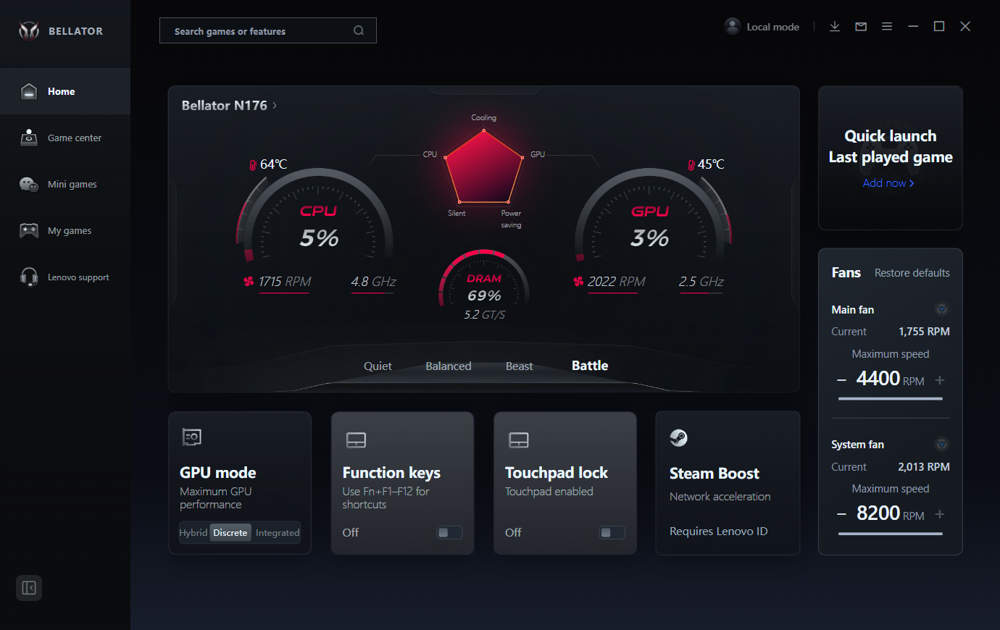
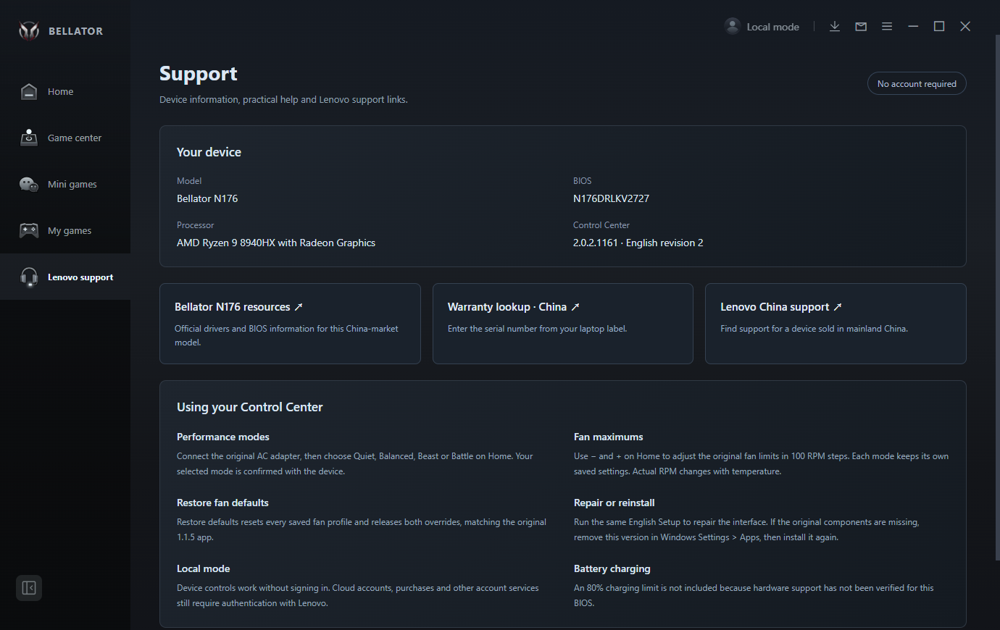
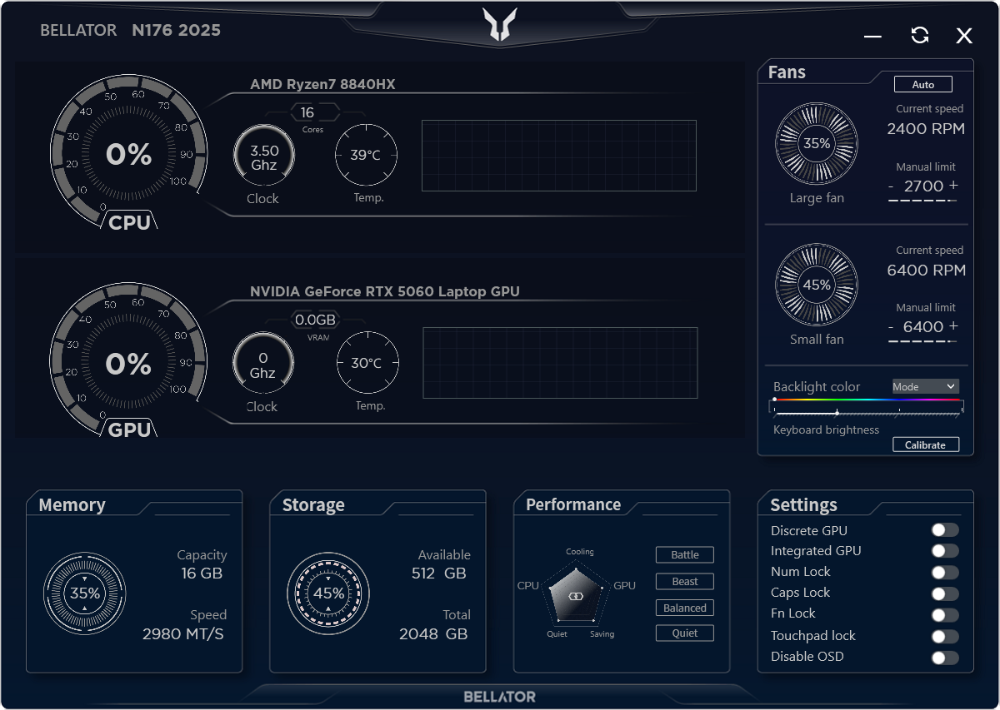

# BELLATOR Control Center 2026 — English R2 for N176

**Developed with Rea** (per project maintainer).  
**Unofficial English localization / compatibility package** for the **Lecoo Bellator N176 (2025 hardware)**, based on the **BELLATOR Control Center 2026** software.

> [!IMPORTANT]
> **2026** refers to the software generation. **N176 (2025)** is the supported laptop model. This is **not** an official Lenovo / Lecoo release or a general-purpose Lenovo utility.



## About this project

The project maintainer used **Rea** while developing this unofficial English R2 adaptation. The app is **BELLATOR Control Center 2026**; **N176 (2025)** identifies the supported laptop hardware, not the software release year.

## Overview

This repository documents an English-language adaptation of BELLATOR Control Center 2026 for the specified Bellator N176 laptop. The existing OEM hardware-control components are described in the included Vietnamese guides; the localization aims to retain the supported hardware functionality.

**The installer and application source code have not been supplied in this repository.** The `docs/` folder contains the user-provided guides, test report and checksums; `screenshots/` contains the supplied UI previews. A binary release must be uploaded separately, only when its redistribution is authorized.

## Hardware compatibility

| Item | Supported / verified configuration |
| --- | --- |
| Device | Lecoo Bellator N176 (2025) |
| CPU | AMD Ryzen 9 8940HX |
| Tested GPU | NVIDIA GeForce RTX 5060 Laptop GPU |
| Tested BIOS | `N176DRLKV2727` |
| Software | BELLATOR Control Center 2026, English R2 / OEM version `2.0.2.1161` |
| Physical systems tested | **1** (per supplied R2 report) |

**Not verified for** N176B, N176C, other N176 CPU configurations, different BIOS revisions, or unrelated Lenovo devices. Avoid installing on unsupported hardware.

## Features documented for English R2

- English Home, Settings, About, Feedback, Support and selected UI resources.
- Performance profiles: **Quiet / Balanced / Beast / Battle**.
- Fan monitoring, per-mode RPM limits in 100 RPM steps and **Restore defaults**.
- GPU mode and supported function-key / touchpad controls.
- Local device controls without Lenovo sign-in.
- Steam Boost requires a Lenovo account and access to the OEM service.

**Limitations:** No unverified battery charge limit / 80% Battery Care toggle; some cloud-fed content remains controlled by the manufacturer. Manual fan limits are caps, not fixed fan-speed targets. For details see [`docs/Huong-dan-R2.txt`](docs/Huong-dan-R2.txt).

## Screenshots

### English R2 — Home


### English R2 — Support


### Prior English 1.1.5 interface (reference)


## Installation

1. **Confirm the exact device model, CPU and BIOS compatibility** above.
2. If an authorized binary release is published, download `BELLATOR-2026-N176-English-R2-Setup.exe` from the GitHub **Releases** section.
3. Verify its SHA-256 before running it:
   ```powershell
   Get-FileHash ".\BELLATOR-2026-N176-English-R2-Setup.exe" -Algorithm SHA256
   ```
   Expected SHA-256 (from the supplied record):
   ```
   8633AB20765C1CD4BCD98292303CA5727FEED2031FBD4590D0A8F5F44CA05CA0
   ```
4. Review [`docs/Huong-dan-R2.txt`](docs/Huong-dan-R2.txt) before running the installer with administrator privileges.
5. Use the original AC adapter when changing power profiles. Do not run competing hardware-control applications simultaneously.

The supplied documentation reports installation and hardware behavior tests on one matching Windows machine. This repository has **not independently re-tested** the submitted binary. The customized installer is **not signed by the original manufacturer**.

## Included files

| Path | Purpose |
| --- | --- |
| `docs/Huong-dan-R2.txt` | R2 compatibility, setup, controls, tested scope and known limitations (Vietnamese) |
| `docs/Huong-dan.txt` | Previous English 1.1.5 version notes (Vietnamese) |
| `docs/Kiem-thu-R2.json` | User-provided R2 test summary |
| `docs/SHA256-R2.txt` | R2 installer SHA-256 |
| `docs/SHA256.txt` | Prior 1.1.5 English installer SHA-256 |
| `screenshots/` | User-provided UI previews |
| `HUONG-DAN-DANG-GITHUB.md` | Vietnamese GitHub upload instructions |
| `RELEASE_NOTES.md` | R2 release notes |

## Safety, trademarks and redistribution

This is an **unofficial** localization effort, not a product of Lenovo, Lecoo or Bellator. Brand names, logos and original program components belong to their respective owners. **Do not redistribute proprietary OEM installers, libraries, logos or other copyrighted material unless you have the necessary rights or permission.** If redistribution rights are unclear, keep the project private and publish only permitted documentation/material.

Any available installer interacts with system hardware controls; test only on supported devices, make backups and keep the OEM recovery option available. No warranty is provided by this repository.

---

**Tiếng Việt:** Đây là project giới thiệu **ứng dụng BELLATOR Control Center 2026 English R2** cho **máy Bellator N176 đời 2025**. File bộ cài `.exe` chưa có trong repository. Xem [hướng dẫn đăng GitHub](HUONG-DAN-DANG-GITHUB.md) và [hướng dẫn sử dụng R2](docs/Huong-dan-R2.txt).
